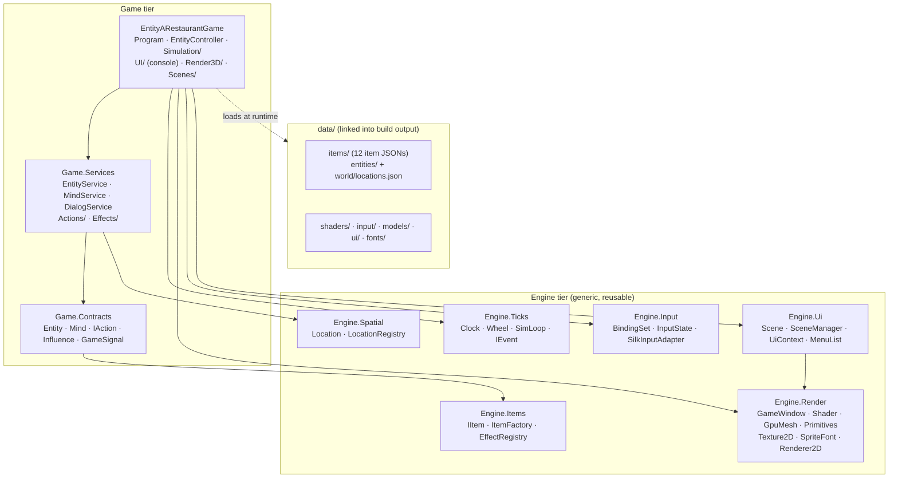
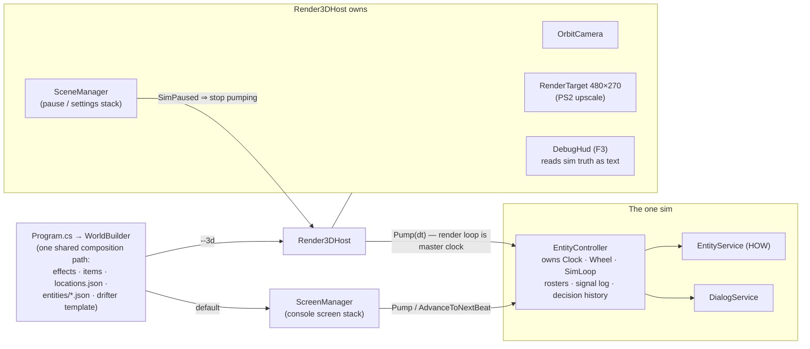
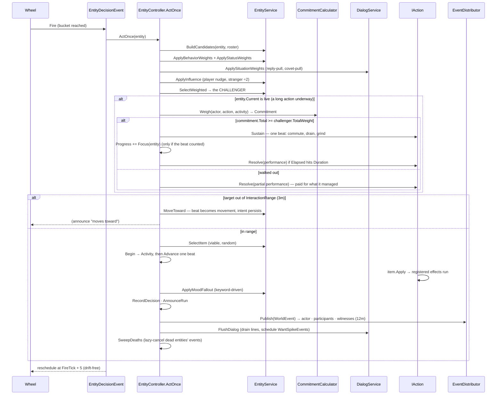
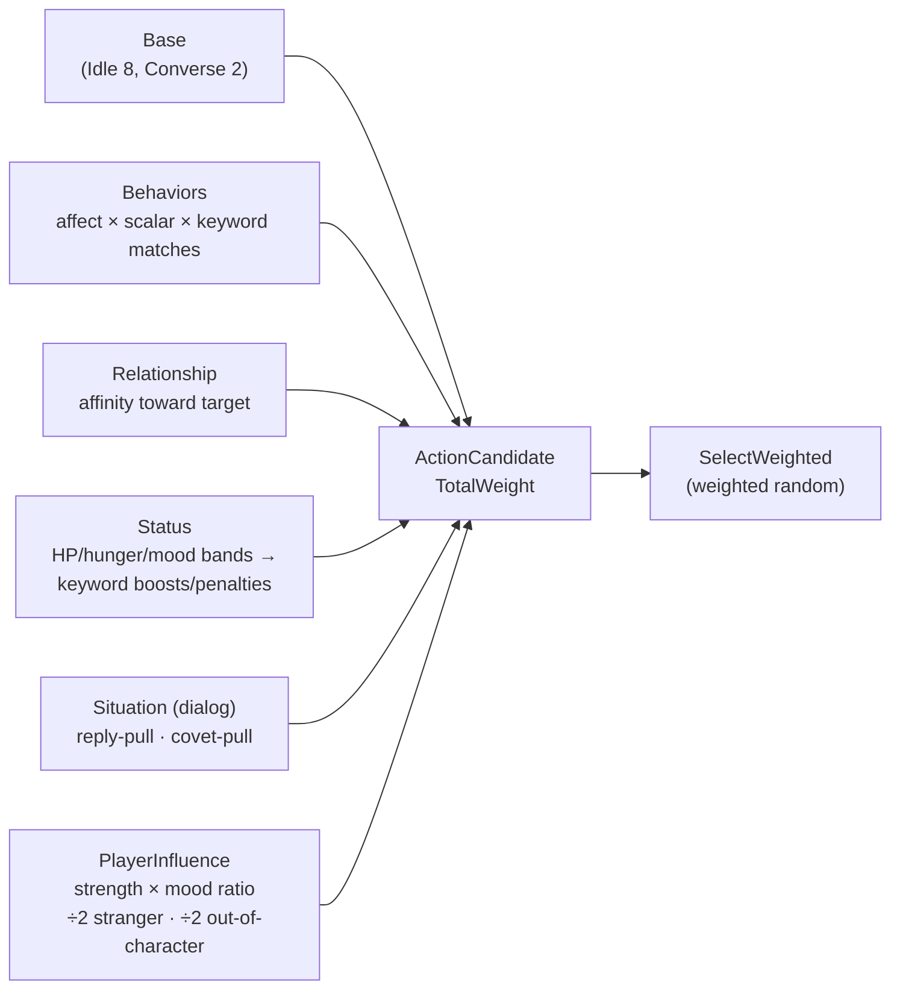
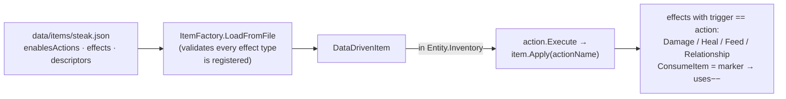
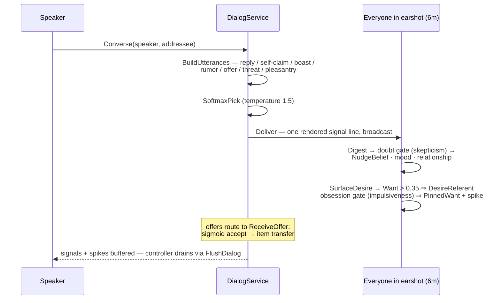
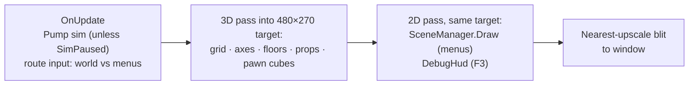
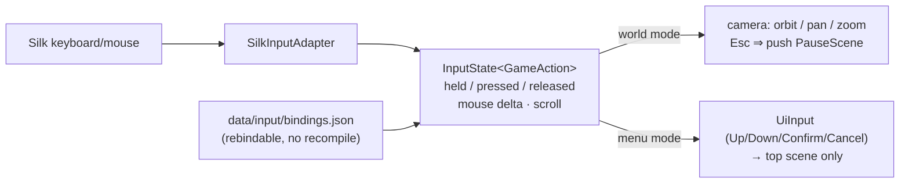

# Project Status — Entity A Restaurant Game

Snapshot date: **2026-07-16**. Companion doc: [RECOMMENDATIONS.md](RECOMMENDATIONS.md)
(formal review + future work, kept separate on purpose).

The diagrams below zoom in layer by layer: solution map → runtime composition →
the sim heartbeat → individual subsystems.

---

## Layer 0 — Solution map (who references whom)

Compiler-enforced: `Engine.*` never references game code; Contracts hold state,
Services hold logic, the game holds time + composition.



External packages (deliberately few): `Silk.NET.{Windowing,OpenGL,Input,Maths}`,
`StbImageSharp`, `StbTrueTypeSharp` — all in Engine.Render/Input only.

---

## Layer 1 — Runtime composition (who owns whom while playing)

Two front-ends over one sim. `--3d` opens the OpenGL view; the default is the
console UI, which stays alive as the debugging fallback.



Rule that holds everywhere: **renderers only READ sim truth.** The sim never
knows a renderer exists. Pausing = not feeding the accumulator (both UIs use
the same trick).

---

## Layer 2 — The sim heartbeat (one decision beat, exact call chain)

Everything is an event arriving at its tick-wheel bucket; nothing polls.
Pacing: 2 ticks/sec · decisions every 5 ticks per entity (staggered) · hunger
pulse every 10.



**Duration 1 is the norm and costs nothing.** An instantaneous verb begins and
settles inside one `ActOnce`, so the commitment branch never runs for it and
the beat is exactly what it was before activities existed. Only an action that
asks for more beats is ever observed in `Entity.Current`.

### Commitment (what makes an entity STAY)

Resolved by comparison against the challenger's weight, never by folding the
incumbent into the roll — a shift weighed 60 against food weighed 20 would be
abandoned with probability 0.25 on *every* beat, and over a whole shift that is
a certainty rather than a risk. Per-beat rolls compound; thresholds do not.

| Term | Weight | When |
|---|---|---|
| `Baseline` | +4 | always — unwillingness to reopen a settled question |
| `Momentum` | +18 | ramps in over the first quarter of the duration, then flat |
| `SettlingPeak` | +10, −3/beat | covers the start, where momentum is weakest |
| `NearlyThere` | +6 | past 75% elapsed |
| `DistressMax` | up to −18 | worst need below the 25% critical line |
| `AddressedBy` | −6 | an un-stale utterance is sitting in `Mind.Deposited` |
| `WhisperPull` | −10 (÷2 stranger) | a player whisper the activity does not already answer |

### The weight pipeline (what makes an entity "want" an action)



Everything keys off **keywords**, never action names — a new keyworded action
automatically participates in status/mood/behavior systems.

---

## Layer 3 — Subsystems

### 3a. Items: JSON → inventory → effects



Descriptors (axis → valence) double as the mind's vocabulary: the same JSON
block feeds item effects *and* what entities believe/want about the item.

### 3b. Dialog: one Converse beat



`WantSpikeEvent` then decays obsessions on the wheel (×0.65 every 10 ticks
until below 0.3). The player's `Whisper` (rumor screen) enters this exact
pipeline; the player's `Influence` lever instead writes
`Entity.PendingInfluence`, consumed in the weight pipeline above.

### 3c. Frame pipeline (3D + 2D share one canvas)



### 3d. Input: device → intent



---

## Feature status table

| System | State | Proof |
|---|---|---|
| Tick wheel / events (Engine.Ticks) | ✅ Solid — wrap-aware, lazy-cancel, drift-free | headless SmokeTest run |
| Item pipeline (Engine.Items + data) | ✅ Solid — validated JSON, 12 items | items load in both UIs |
| Data-driven world (entities + locations) | ✅ WorldBuilder + data/entities, data/world (2026-07-17) | both harnesses run it |
| Procedural worldgen (regions/settlements/residents) | ✅ Seeded, pool-driven, deterministic; one settlement simulated live (2026-07-18) — see specs/implemented/WorldGen_Design.md | `--gen 42` smoke + dump |
| Purpose systems: Work-as-choice, factions, wildlife, loot-on-kill | ✅ Landed 2026-07-18 — see specs/implemented/SimDepth_Purpose_Plan.md outcome log; keyword-aware clamped relationship weighting fixed en route | SoakTest: first surviving settlement |
| Soak/stress harness (tools/SoakTest) | ✅ Headless `--gen` runs, N-thousand ticks, economy/violence stats, `-v` verbose | 4000-tick runs at ~20–50k ticks/s |
| Personal space / separation | ✅ 2026-07-18 — `Entity.Radius` footprint (default 0.6); `EntityService.ResolveOverlaps` relaxation pass after every decision beat keeps pairs ≥ sum-of-radii apart. Interactions still happen at range (3m); entities never envelop each other | smoke screenshot + soak |
| Arrivals/departures (Track D) · status-band rethink (P2.19) | 🔲 Next — deprioritized/flagged in design review | — |
| Decision loop / weights | ✅ Solid — 6 weight sources | SmokeTest + console |
| Long-running actions (jobs) | ✅ 2026-08-26 — `IAction.Duration/Sustain/Resolve` (defaults keep every existing verb instantaneous), `Entity.Current` activity, `CommitmentCalculator`, `EntityService.Focus`; `WorkAction` is a shift paid on performance. See specs/implemented/Activities_And_Events.md | soak `-v`: `Work (1.00)` … `Work, cut short (0.50)`; probe selftest PASS |
| Event spine / distributor | ✅ 2026-08-26 — typed `WorldEvent` ledger behind every announce, audience tiers actor/participant/witness (12m), `IEventReaction` seam. Witnesses reach reactions always, logs only when loud | SmokeTest: 293 witness slots reached in a 3-entity world |
| Dialog / minds / desires | ✅ Implemented (see specs/implemented/Dialog_Implementation_Map.md) | console MindScreen |
| Influence / rumor (player verbs) | ✅ Implemented | console screens |
| Console UI (9 screens) | ✅ Working — now the debug fallback | default run path |
| 3D window/camera/meshes/OBJ | ✅ Working | smoke screenshot |
| Rebindable input | ✅ Working | bindings.json |
| 2D UI foundation (scenes, font, images) | ✅ Working — pause + settings stub | smoke screenshot |
| Debug HUD (text over 3D) | ✅ Working — F3: roster stats, decisions, full signal log | smoke screenshot |
| Per-entity logs + tiered speech bubbles | ✅ 2026-07-18 — every announce writes actor/other dossiers; LOUD tier (speech, deals, violence, deaths) renders as bubbles over pawns; quiet tier is dossier-only. Replaced the bottom SignalTicker (removed as too noisy) | smoke screenshot |
| Click-to-inspect (mouse picking) | ✅ 2026-07-18 — left-click picks the nearest projected pawn; 2-page micromenu (Log / Items, Enter flips, Up/Down scrolls) rides beside the live sim; click another pawn to retarget | smoke screenshot |
| Title / settings / inventory-verbs / interaction / conversation UI | 🔲 Next — see specs/active/UI_2D_Interface_Plan.md build order | — |
| Regions/settlements view | 🔲 Deliberately separate controller (not UI scenes) | project decision |
| Item PNGs beside bubbles | 🔲 Future project (user-flagged) | — |
| Audio, save/load | 🔲 Not started | — |

## How to run

```
dotnet run --project src\EntityARestaurantGame            # console UI (debug fallback)
dotnet run --project src\EntityARestaurantGame -- --3d    # 3D + 2D interface
dotnet run --project src\EntityARestaurantGame -- --3d --smoke   # auto-close + screenshot
dotnet run --project src\EntityARestaurantGame -- --gen 42 --3d  # procedurally generated world
                                                                  # (--gen alone = fresh seed; --dump
                                                                  #  writes it out as content files)
dotnet run --project tools\SmokeTest                      # headless sim exercise
```

In 3D: WASD pan · right-drag orbit · scroll zoom · **Esc** pause menu ·
**F3** debug HUD. Fonts: drop a `.ttf` in `data/fonts/`. Menu art: drop images
in `data/ui/`.
