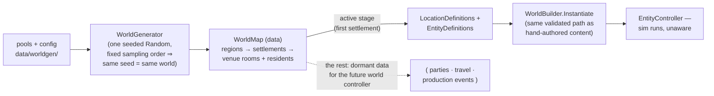

# World Generation — Design & Straight Talk

Drafted 2026-07-17. Aligned with `docs-6-11/WorldDesignCheckpoint.md` (regions →
settlements → parties → pawns; the world persists, you don't).

---

## 1. The straight talk (read this before the knobs)

**Generating a world is the cheap, safe part. Simulating one is the expensive
part.** Pools + knobs + a seed can stamp out regions, settlements, and
residents all day — it's just data. What v1 does with that honesty:

1. **The whole world generates as data** — every region, settlement, and
   resident, deterministic from one seed.
2. **Exactly one settlement is simulated live** (the "active stage"), through
   the exact same controller/service pipeline the restaurant uses today. The
   sim never learns the world got bigger.
3. **Everything else is dormant data** — real definitions, inspectable and
   dumpable, waiting for the systems that will consume them (parties, travel,
   settlement production events, the dormancy layer). We deliberately deleted
   the unused `EventTimeline` seam yesterday; it comes back **when multi-
   settlement simulation actually consumes it**, not before.

Two more honest constraints:

- **Region size is map data, not sim space.** The sim's tuning constants
  (3m interaction range, 6m earshot, 2.5m/decision movement) assume a
  ~20m chamber. So venue templates stay in that envelope, and `regionSize`
  only governs where settlements sit on the (future) world map. Making the
  number bigger makes the map bigger, not the rooms.
- **No parties/factions/economy yet.** Per the checkpoint doc those are the
  next altitude (party as unit of agency, settlements as production anchors).
  Generating faction stubs nothing reads would be manufacturing dead data —
  the thing we just spent a session deleting. The schema leaves room; the
  generator doesn't fill it until something consumes it.

**Why this is safe for modded content:** the generator does not invent a new
format. It *emits the same `EntityDefinition` / `LocationDefinition` shapes*
that `data/entities/` and `data/world/` use — then instantiates them through
the same validated `WorldBuilder` path. Hand-authored, modded, and generated
content are literally indistinguishable downstream. A typo'd axis or unknown
action in a mod pool fails at load with a message, same as always
(`JsonUnmappedMemberHandling.Disallow` everywhere).

## 2. The knobs — `data/worldgen/config.json`

| Knob | Type | Meaning |
|---|---|---|
| `seed` | int or null | null = roll a fresh seed each run (always printed, so you can pin a world you liked). CLI `--gen <seed>` overrides. |
| `regionCount` | int | How many regions to stamp. Names come from the region pool; more regions than names = numbered suffixes. |
| `regionSize` | [w, h] | Abstract map extent per region. Settlement placement only (see straight talk). |
| `settlementsPerRegion` | [min, max] | Rolled per region. |

Resident counts are *not* a global knob — they emerge from each archetype's
`perSettlement` range, which is the more moddable place for them.

## 3. The pools — all moddable, all JSON

```
data/worldgen/
├── config.json          # the knobs above
├── names.json           # region names, settlement prefix+suffix parts, first names
├── venues.json          # venue templates: named sets of room AABBs (LocationDefinition shape)
└── archetypes/*.json    # resident archetypes: EntityDefinition + [min,max] ranges
```

**Archetypes are ranged EntityDefinitions.** Wherever a hand-authored entity
has a number, an archetype has `[min, max]` (inclusive; equal ends = fixed).
Wherever it has a fixed inventory, an archetype has `always` + a `pool` with
`pickCount`. Sampled per resident:

```jsonc
{
  "type": "Cook",
  "perSettlement": [1, 1],
  "behaviors": [ { "name": "Diligence", "keywords": ["Supportive","Reactive"], "affect": [2, 4] } ],
  "actions": ["Attack","Defend","Consume","Enchant","Converse","Idle"],
  "mind": {
    "preferences": { "Craft": [4, 7], "Nourishment": [3, 5] },
    "skepticism": [0.3, 0.7],
    "impulsiveness": [0.2, 0.6]
  },
  "selfDescriptors": { "Craft": [0.3, 0.7] },
  "stats": { "strength": [8, 13] },
  "inventory": { "always": ["fist"], "pickCount": [1, 2], "pool": ["kitchen_knife","bread_loaf"] }
}
```

Everything references existing vocabulary: item ids resolve through the item
factory, actions through the action map, axes against `Axes.All` — all at
load time. **Dropping a new archetype JSON in the folder is the whole modding
story.**

## 4. Pipeline



Per resident, the generator samples: display name (per-settlement shuffled
pool), behaviors' affects, mind preferences/skepticism/impulsiveness,
self-descriptors, stat overrides, inventory picks, a spawn position inside
the venue, and a sprinkle of seeded relationships between co-residents.

## 5. Running it

```
dotnet run --project src\EntityARestaurantGame -- --gen            # fresh seed (printed)
dotnet run --project src\EntityARestaurantGame -- --gen 42 --3d    # pinned world, 3D
dotnet run --project src\EntityARestaurantGame -- --gen 42 --dump  # also write the generated
                                                                   # defs to data/generated/42/
```

`--dump` matters for modding: a generated settlement writes out as ordinary
`entities/*.json` + `locations.json` files — a world you liked can be
promoted to hand-authored content by copying files.

Without `--gen`, nothing changes: the handcrafted restaurant loads exactly
as before.

## 6. Deliberately NOT in v1 (and where it's headed)

| Not generated | Why | Lands with |
|---|---|---|
| Parties / factions | Nothing consumes them; party-AI is its own system | checkpoint §1, §6 |
| Settlement production / economy | Needs the per-settlement `WorldObligation` events | checkpoint §2–4 |
| Live sim of non-active settlements | Needs the dormancy layer (re-add `EventTimeline` when consumed) | dormancy design |
| Travel between settlements | Needs parties (the mobile unit) first | checkpoint §1 |
| World map rendering | Regions/settlements are explicitly NOT UI scenes — separate controller | project decision 2026-07-16 |
| Persistence of a generated world | Save/load groundwork is R7 | RECOMMENDATIONS.md |
